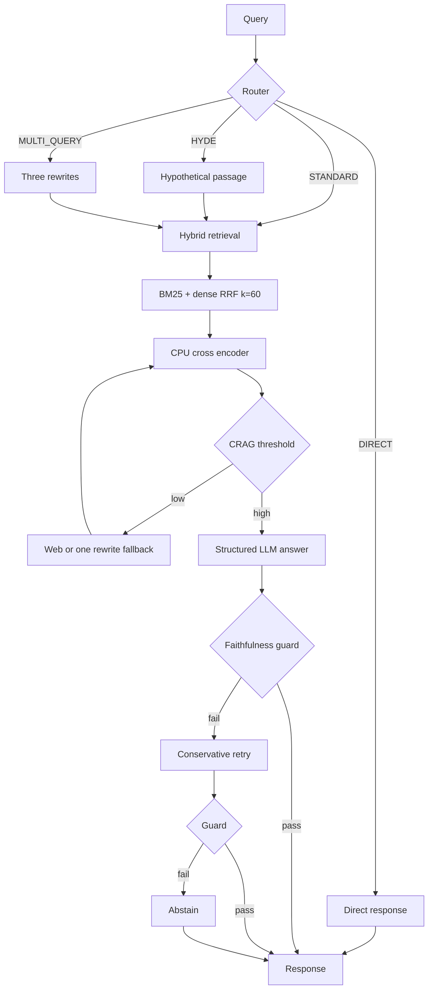

# Adaptive & Corrective RAG Engine

Typed Python service for CPU retrieval with explicit routing, hybrid search, reranking, corrective fallback, structured generation, and a second faithfulness check. This is an implementation of the attached design, with performance claims left as targets until measured on a real corpus.

## Architecture



## Run locally

Requires Python 3.11+ and an OpenAI API key. First startup downloads CPU models; subsequent starts use the model cache. The local Qdrant directory holds indexed vectors and payloads. No Docker or GPU is required.

For OpenRouter, set `OPENAI_BASE_URL=https://openrouter.ai/api/v1`, put the `sk-or-...` key in `OPENAI_API_KEY`, and set `AC_RAG_LLM_MODEL` to a provider/model slug such as `openai/gpt-4o-mini`.

```powershell
python -m venv .venv
.venv\Scripts\Activate.ps1
pip install -e ".[test]"
Copy-Item .env.example .env
# Edit .env and set OPENAI_API_KEY
uvicorn ac_rag.api:app --host 127.0.0.1 --port 8000
```

```powershell
ac-rag ingest .\example.pdf --source example.pdf
ac-rag query "What does the document say about the rollout?"
```

Or use the REST API:

```powershell
Invoke-RestMethod http://127.0.0.1:8000/ingest -Method Post -ContentType application/json -Body '{"source":"memo","text":"The rollout starts in November."}'
Invoke-RestMethod http://127.0.0.1:8000/query -Method Post -ContentType application/json -Body '{"query":"When does the rollout start?"}'
```

For a smoke test, `GET /health` should return `status: ok` and a chunk count. Index a short passage with `/ingest`, then ask a question whose answer appears in that passage using `/query`. Verify that `citations` contains an ID from `chunk_ids`, `sources` contains the same passage, and `reasoning_trace` ends with `guard:pass` or `guard:retry_pass`. Ask an unrelated document question to check that the service abstains when evidence is weak. With a bearer token configured, add `Authorization: Bearer <token>` to ingestion and query requests.

`POST /query/stream` emits SSE `status`, `token`, and `result` events. Tokens are emitted after validation so unsupported text cannot leak before the guard completes. This is incremental answer delivery, not provider token streaming. The `reasoning_trace` field records pipeline events only and does not expose hidden model reasoning.

## Design notes

- Embeddings use `BAAI/bge-small-en-v1.5` for English and `cointegrated/rubert-tiny2` for Russian. Qdrant collections are separated by language because vector dimensions can differ. A query searches its detected language only.
- The configured cross encoder is English trained. Its sigmoid score is a routing heuristic, not a calibrated probability. Tune the `0.65` threshold per corpus and language. For Russian production traffic, evaluate and configure a multilingual reranker.
- BM25 is rebuilt from Qdrant payloads on process startup. One process owns a local Qdrant path; use a Qdrant server and a shared sparse index for multiworker deployment.
- Reingesting a source replaces its prior chunks. Chunk IDs are stable 63 bit hashes of source and chunk index. Source content is treated as data, never as instructions.
- CLI ingestion accepts UTF-8 `.txt`/`.md`, text-based `.pdf`, and `.docx`. Scanned PDFs need OCR before ingestion.
- Web fallback is opt in with `AC_RAG_ENABLE_WEB=true` and `AC_RAG_TAVILY_API_KEY`. Otherwise the fallback reformulates queries once. If evidence stays weak or the guard fails twice, the service abstains.
- The example binds to localhost. Set `AC_RAG_SERVICE_API_KEY` to require a bearer token on ingestion and queries; put request limits and TLS at the reverse proxy before exposing the API publicly. API keys belong in environment variables, never in Git.

## Evaluation

Targets from the design: CPU routing/retrieval under 150 ms, Precision@K improvement of 25–30%, and fewer generation calls. These are **unverified**. The latency target excludes first model download and LLM network time. The generator and guard themselves add LLM calls; measure end to end costs instead of assuming a 40% reduction.

Create an annotated JSONL file with `query` and `relevant_chunk_ids` for documents already ingested; `eval/example.jsonl` only illustrates the format and is not a valid benchmark until the corresponding ID exists. Then run:

```powershell
python scripts/benchmark.py eval/my_corpus.jsonl --output results/retrieval.json -k 5
pytest -q
```

| Metric | Naive dense | Adaptive hybrid | Status |
|---|---:|---:|---|
| Precision@5 | — | — | Run annotated benchmark |
| Median retrieval latency | — | — | Run annotated benchmark |
| Faithfulness | — | — | Requires independently labeled answer set |
| Cost per query | — | — | Requires provider token usage and price snapshot |

The benchmark compares the same indexed corpus using dense top K against BM25+dense RRF and reranking. It records retrieval latency and precision/recall only. It does not manufacture RAGAS, trace screenshots, or provider cost. Production observability can be added through OpenTelemetry/Phoenix; the current response exposes per-request route, timing, and LLM call count.

## Test

`pytest` covers routing, RRF, citation allowlisting, and abstention after failed verification. It uses fake model adapters and needs no downloaded weights or API calls.
